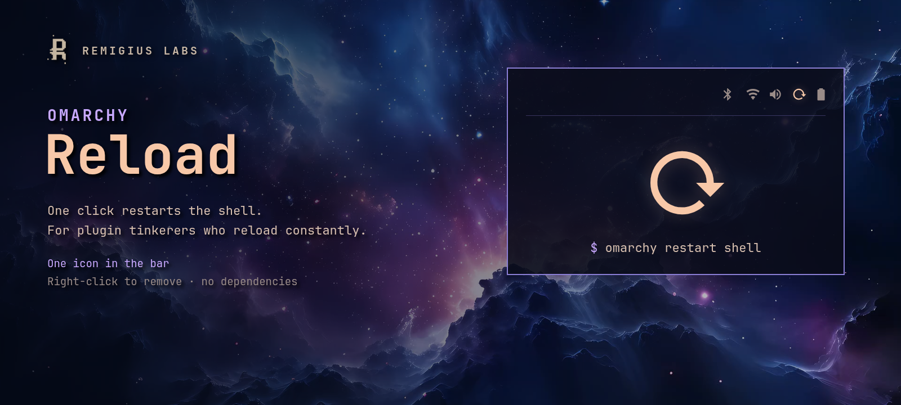

# Reload



One bar icon (󰑓) that restarts the [Omarchy](https://omarchy.org) shell.

If you build or tweak shell plugins, you reload constantly. This makes it one
click instead of a terminal round-trip — it just runs `omarchy restart shell`,
detached so the restart survives the shell it was clicked in.

Right-click the icon to remove it from the bar (`omarchy plugin enable remi.reload` brings it back).

That's the entire plugin.

## Install

```bash
omarchy plugin add https://github.com/remigius-labs/omarchy-reload.git --enable
```

## Remove

```bash
omarchy plugin remove remi.reload
```

No dependencies beyond the Omarchy shell.
